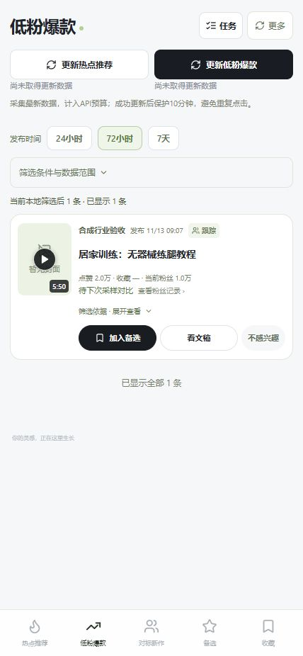

# 自媒体选题工作台

少刷无关视频，更快找到值得做的选题。由鸡毛灰上天整理的 Windows 本地自媒体选题工作台，适用于不同内容行业。

**当前版本：v0.3.0-beta，公开测试版。** 工具代码采用 MIT 许可证；TikHub 数据接口、DeepSeek 模型调用可能收费，由使用者自行配置账号、核对价格和设置预算。

[下载 Skill ZIP](https://github.com/jimaofeishangtian-ai/creator-workbench/releases/tag/v0.3.0-beta) · [图文使用手册](docs/guide.pdf) · [功能与测试说明](docs/RELEASE-TESTS.md)

## 先看它能做什么

| 入口 | 用途 |
|---|---|
| 热点推荐 | 从已采集的行业相关样本中筛近期高赞作品，可切换发布时间与点赞门槛，不限制作者粉丝数 |
| 低粉爆款 | 叠加相关性、时间、粉丝数、最低点赞、点赞/粉丝比筛选，可只用关键词而不配置对标 |
| 对标新作 | 跟踪自己选定的抖音博主，查看近7天相关新作 |
| 备选 | 长期保留选中的题材，记录想做的原因，按标题、作者和备注找回 |
| 收藏 | 同步本人抖音收藏，按分类/关键词查找、人工纠正分类、按需补全公开数据 |

- 点击封面打开原片；封面显示时长，缺失字段保留未知。
- 按需提取文稿并让 DeepSeek 拆解结构、开头；也可粘贴已有文稿。
- 按需分析视频抽样画面与前5秒，不冒充连续看完视频或准确识别全部声音。
- 记录作者粉丝采样，有真实前后数据才比较增长。
- 手机/电脑共享数据，任务中心展示排队、进度、取消与失败原因。
- 本机备份、恢复和 JSON 导出；运行数据与 API 密钥不随分享包提供。

<details><summary>手机界面示例（合成验收数据）</summary>



</details>

## 安装：把工作交给 Agent

1. 从 Releases 下载 Skill ZIP 并解压。需要具备本机文件、命令能力的 Agent；浏览器自动连接还需要它能操作你已有登录的浏览器。
2. 把下面这段话和解压目录交给 Agent：

> 读取这个文件夹根目录的 SKILL.md，帮我安装自媒体选题工作台。先问清我的行业、受众、兴趣赛道、想参考和不想看的内容、对标和预算。再生成领域匹配词、发现关键词、分类与有来源的发布标签。复用我已经登录抖音的浏览器，不导出 Cookie、不重登；先验证本地功能，不擅自开启付费自动化。

3. 按提示安装依赖、由你自己设置至少8位密码，连接自己的浏览器。Chrome/Edge为标准扩展路线；其他 Chromium 浏览器视版本验收。
4. 需要公开数据采集和搜索时，配置自己的 TikHub；需要应用内拆解时配置 DeepSeek。核对价格与预算后再开启自动化。
5. 需要手机访问时，在电脑「手机与设备」开启扫码连接，手机5G扫描后输入工作台密码。

目标环境：Windows，Python 3.10-3.12，Node.js 20.19+ 或 22.12+，已有 Chrome/Edge。第一次安装需要联网。FFmpeg及本机 Whisper 转写组件按需安装，不是浏览已有素材的前提。

手动安装命令（在包根目录）：

```powershell
python scripts/workbench.py doctor
python assets/workbench/scripts/install.py
python assets/workbench/scripts/start.py
```

如需本机语音转写，安装器可加 `--with-asr`，同时准备 FFmpeg；Whisper 模型首次下载需另行启用。没有相关组件时可直接粘贴文稿。

## 三类词分开，避免乱搜乱花钱

- **领域匹配词**：本地判断相关性，不产生 TikHub 请求。
- **发现关键词**：交给 TikHub 查素材，在手动/已启用的定时任务中产生请求。
- **发布话题标签**：记录主题或活动及其来源、核验状态和日期，不自动变成搜索词，不自动报名/投稿。

Agent 先做三组行业访谈，通常从3-8个准确搜索词起步。AI话题可参考 [BetterOPC](https://betteropc.com/self-media/traffic-tags)；它是第三方整理，活动资格和期限需向活动方核实，不能承诺带标签就获得流量。其他行业不套用AI清单。

## 费用和运行方式

新装默认关闭自动化。启用后的默认安排：收藏/对标每24小时，关键词北京时间每天08:30，热点发现每天08:40（热点需单独启用）。电脑/服务必须在线，收藏还依赖采集浏览器可用。

浏览、筛选、备选和分类等本地操作不请求付费数据。采集、公开信息补全和应用内模型分析可能计费。作者资料共用24小时样本；活动任务去重；近期成功更新短时复用；普通接口不自动重试，热点重试尽量只补失败查询。不同关键词、排序、分页即使返回同一视频，仍可能分别计费。具体费用以供应商账单为准，本地预算只是按保存单价控制预估。

手机采用按需开启的临时HTTPS连接，无需自备域名或手机Tailscale应用。需要独立工作台密码；电脑关机/休眠会断开，重建连接会更换地址，桌面快捷方式也可能需要更新。不要把你自己的连接二维码和密码当作给粉丝的安装入口。

## 当前边界

- 结果是本机采集样本的筛选，不是全站榜单，不保证不漏热点或选题必爆。
- 未提供的数据保留未知，不伪造播放量、收藏时间、粉丝历史。
- 不提供自动发布、完整脚本/商单制作、数字人、自动剪辑或 Obsidian 同步；小红书采集未接入。
- 宿主 Agent 的浏览器能力因产品/版本而异。WorkBuddy、豆包等新机器原生导入及真实浏览器配对尚未逐一端到端验收。
- 不承诺平台账号零风控风险；遇登录失效或验证应停止并由本人处理，不绕过验证。

## 数据与许可

应用数据在 `assets/workbench/runtime/`；不要再打包自己的 runtime、密钥、缓存、日志或浏览器资料。源码 MIT；前端第三方许可见 [THIRD-PARTY-NOTICES](assets/workbench/THIRD-PARTY-NOTICES.md)。反馈问题时附版本、复现步骤和已脱敏错误，不提交密码、API Key、Cookie或私人收藏数据。
