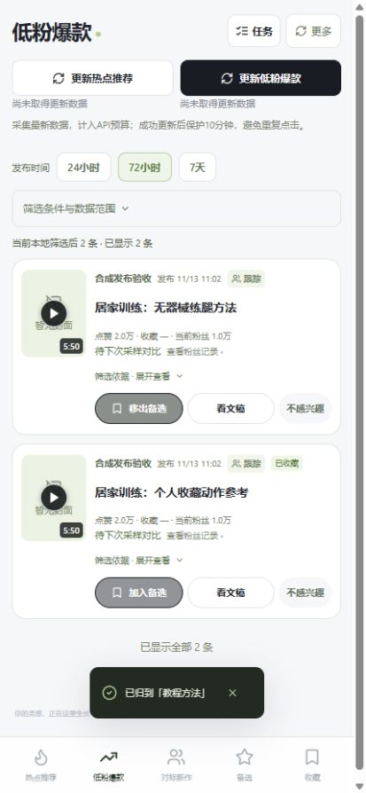

# v0.3.0-beta 发布验收

验收日期：2026-11-13。此版本为 Windows 公开测试版。

## 实际执行

- 从 Skill ZIP 解压到独立目录，运行真实安装器：建立全新 Python 虚拟环境，安装核心依赖，执行 npm ci 和 TypeScript/Vite 构建，成功。
- 启动器遇到已被另一工作台占用的 8765 端口时明确停止，没有接管或关闭原实例。
- 独立安装环境后端全量测试：230 通过、12 跳过。跳过项为已退役的知识库、商单及制作链路，不代表这些功能已提供。存在一条不影响结果的 TestClient 依赖弃用提醒。
- 最后分类及推荐理由修正后，32 项相关回归通过；前端 5 项辅助测试及最终生产构建通过。
- 独立无密钥、无任务执行器的合成数据库，实点登录、非 AI 行业推荐、备选备注保存与搜索、文稿任务提交与取消、任务通知直达、收藏分类和五项手机导航。
- 428px 与 320px 手机宽度无横向溢出；桌面布局保留。
- 测试没有访问真实抖音、没有读取登录 Cookie、没有调用 TikHub/DeepSeek，没有产生供应商费用。

## 此次修复

- 已有字幕优先读取，不再因未安装 Whisper/FFmpeg 而提前失败；取消字幕任务不会继续进入转写。
- 非 AI 行业的收藏快捷分类使用用户配置，避免固定出现 AI 分类；修正重复的“其他”选项。
- 去掉重复的本地领域匹配理由。

## 费用与数据保护回归

覆盖活动任务去重、成功更新短时复用、作者资料共用 24 小时样本、失败冷却、热点逐查询续接、手动与每日任务避免整轮重复、预算拒绝与取消。

这些机制减少重复请求，不保证不同关键词或排序不会返回同一作品：供应商仍可能按每次请求计费。预算为本地保存单价的估算，最终账单以供应商为准。

新安装无账号数据、无 API 密钥、无默认对标、不开启付费自动化；行业方向需由用户与 Agent 访谈配置。

## 实测边界

- 在同一台 Windows 电脑的全新安装目录测试，不等于每一台新机器均已验收。
- WorkBuddy、豆包等宿主的原生导入和全部浏览器组合，尚未逐一实机端到端测试。Chrome/Edge 为标准路线，其他 Chromium 浏览器依版本判断。
- 浏览器扩展真实收藏接入和手机 5G 访问需由每个安装者现场确认；测试图为合成数据。
- 本机 Whisper 的重型可选依赖及 GPU 性能没有在此次安装回归中重新测试。
- 不包含自动发布、完整写稿/商单制作、数字人、自动剪辑、Obsidian 同步或小红书采集。

